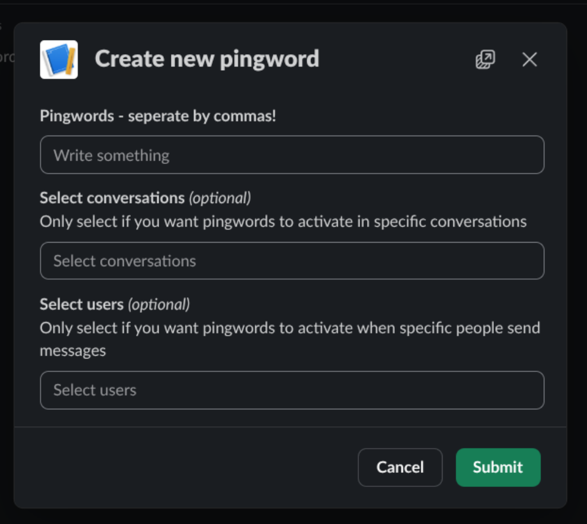

## Sun Oct 18 2026 11:50:26 AM (UTC+05:30)
I've started working on this project. Currently considering [TortoiseORM](https://tortoise.github.io/) to go with the database.

## Sun Oct 18 2026 08:43:51 PM (UTC+05:30) (44m logged)
Aight, I think I have set up TortoiseORM. Currently working on the Slack integration.

## Sun Oct 18 2026 09:06:41 PM (UTC+05:30) (1h 5m logged)
I have FastAPI + Slack (basic stuff) already set up, I think I am ready to start!

## Mon Oct 19 2026 10:07:12 PM (UTC+05:30) (1h 46m logged)
I created this UI, as a starting point. I will now try and figure out how I can add this to the App Home.

## Mon Oct 19 2026 10:58:28 PM (UTC+05:30)
Figured out how to add it to the app home :check-kavyansh:

## Mon Oct 19 2026 11:16:34 PM (UTC+05:30)
Created this cool-looking modal.

## Tue Oct 20 2026 04:52:06 PM (UTC+05:30) (3h 24m logged)
I have refactored some of the code, and also made the buttons not clear the rest of the form. I also have some logic to parse the inputs of the form now. I hate how Slack outputs a `state` object, but doesnt let us put that back into the form when we need to.

## Wed Oct 21 2026 10:31:03 AM (UTC+05:30) (4h 45m logged)
Okay, so I've added the subscriptions thing and set up migrations. This means tortoise can actually make migrations and create the database.

## Wed Oct 21 2026 06:07:57 PM (UTC+05:30)
I think I have ran into an issue. I cant subscribe to all public channels without the bot being in them.

The Slack user client temporarily subscribes to channels when you visit them. I feel like this can be used to bypass this issue.

## Thu Oct 22 2026 05:28:11 PM (UTC+05:30) (6h 32m logged)
I think I figured something out! You know when you open Slack, and go to a public channel you aren't in and you can see live messages? Yeah! Slack uses a `temp_channel_sub` event to temporarily subscribe to those channels while your Slack is open. Turns out, those channels *stay subscribed to* even when you switch to a different channel.

Abusing this, its possible to list all public channels, and subscribe to each one. This is surprisingly fast and takes around 20-25 seconds to subscribe to all channels. After you're subscribed, you get all messages in all public channels *instantly*.

The thing that takes the longest time to subscribe to all channels is listing all 18.5k channels, since Slack only sends 1000 channels per request, and to get more channels you must use the `nextCursor` you get from the response and put it in the next request. So, you gotta wait for the 20 requests to complete.

This means you get *all* events going on on Slack, including when a new member joins, leaves, or someone types in any channels, while we wont be using these for now, its useful to know we can do this.

The next thing I am gonna do is figure out a way to send these events to Slack bolt so I can use all the fancy cool features without having to do anything myself.

# Fri Oct 23 2026 09:53:42 PM (UTC+05:30) (7h 27m logged)
I've refactored a the entire custom user-client thingy!

Now the main implementation lives at `websockets.py` as a reusable `SlackWebsocketClient` class.

This means the code is way cleaner and easier to understand now, as most of the stuff going on with websockets can be abstracted away.

## Sat Oct 24 2026 07:51:53 PM (UTC+05:30) (9h 41m logged)
Guh. This is so frustraiting. I am trying to figure out how to send mock requests to `/slack/events`, but Slack Bolt keeps refusing all the ways I try.

I've decided to use a bit of LLMs to help with this. (sorry!)

My LLM wrote one line in `hooks.py`. It added `"type": "event_callback"` (I forgot add it while I was copying params from the Slack docs)

I've figured out everything that'd make the subscriptions work in channels the bot isn't in now!

This wasnt exactly easy, but it was hacking, and it was quite fun too!

Also, the subscriptions werent working even after `"type": "event_callback"` was added, that was because I didnt add the `team_id` param to the `event` payload I was sending off. Adding that made it work flawlessly.

There is still a bit of work tho, for example, when **@Pingpheus** is in a public channel and a pingword gets triggered there, it'll trigger twice. I'll need to find a way to make sure the userbot doesnt temp subscribe to channels the bot is in, or check if the event payload (in the bot end) is from the userbot in a channel the bot is in.
