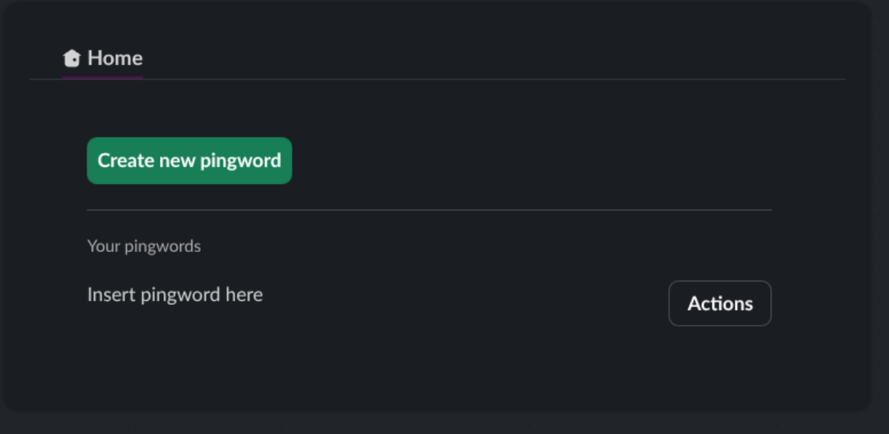

## Sun Oct 18 2026 11:50:26 AM (UTC+05:30)
I've started working on this project. Currently considering [TortoiseORM](https://tortoise.github.io/) to go with the database.

## Sun Oct 18 2026 08:43:51 PM (UTC+05:30) (44m logged)
Aight, I think I have set up TortoiseORM. Currently working on the Slack integration.

## Sun Oct 18 2026 09:06:41 PM (UTC+05:30) (1h 5m logged)
I have FastAPI + Slack (basic stuff) already set up, I think I am ready to start!

## Mon Oct 19 2026 10:07:12 PM (UTC+05:30) (1h 46m logged)
I created this UI, as a starting point. I will now try and figure out how I can add this to the App Home.

# Mon Oct 19 2026 10:58:28 PM (UTC+05:30)
Figured out how to add it to the app home :check-kavyansh: